<!-- Tech stack badges -->
<p align="center">
  <!-- Frontend -->
  
  
  
  
  
  
  
  
  
  
  
  
  
  
  
</p>
<p align="center">
  <!-- Desktop / backend -->
  
  
  
  
  
  
</p>
<p align="center">
  <!-- Tooling -->
  
  
  
  
</p>

<br />

<p align="center">
  
</p>

<h1 align="center">MapCreator</h1>

<p align="center">
  <b>Open source map editor for Windows.</b><br />
  Draw lines, polygons and markers, write descriptions and export your map to PDF using your own HTML template.
</p>

<p align="center">
  <a href="https://github.com/TimiDev-be/MapCreator/releases/latest"><b>Download</b></a>
  ·
  <a href="#features">Features</a>
  ·
  <a href="#templates">Templates</a>
  ·
  <a href="#development">Development</a>
</p>

---

## Preview

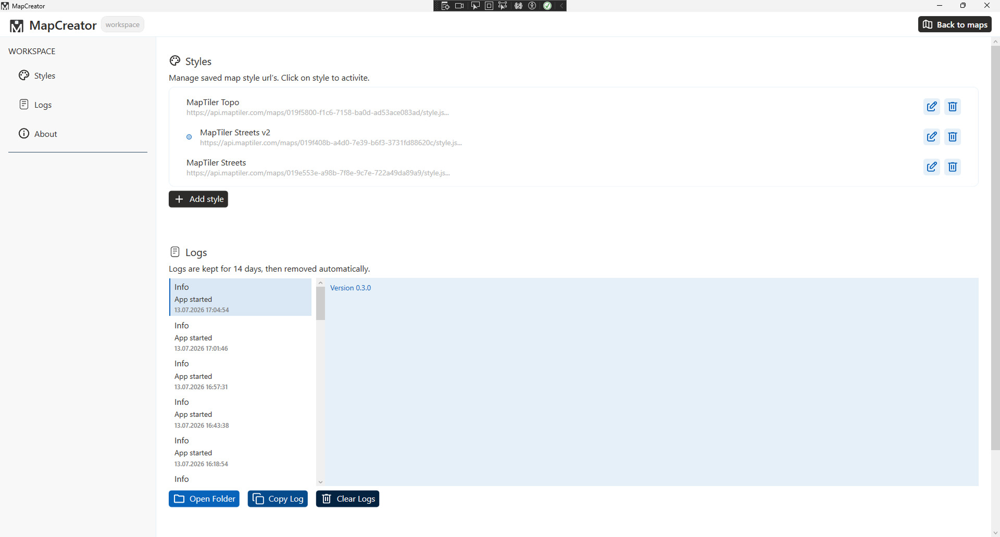

<details>
<summary><b>More screenshots</b></summary>

### Welcome page
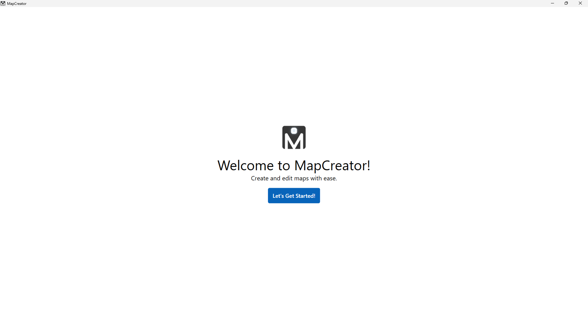

### Maps list page
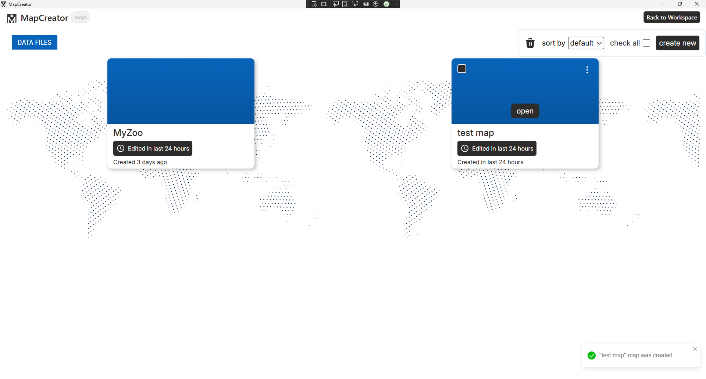

### New map page
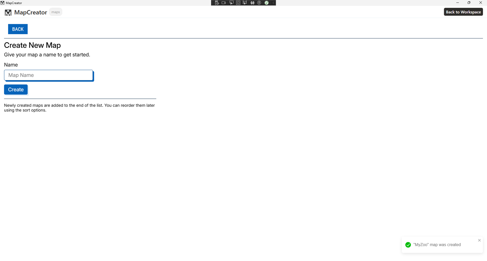

### Data files page and template preview
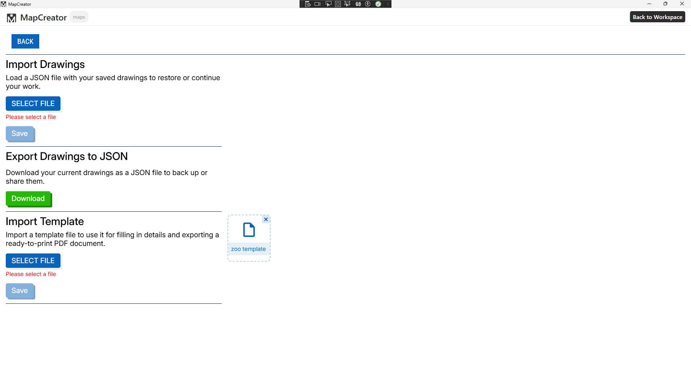 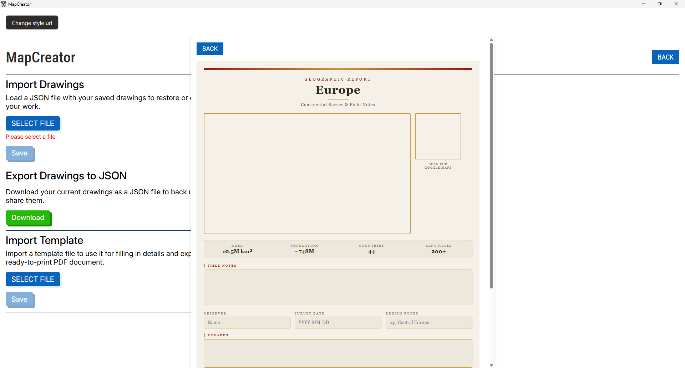

### Settings panel
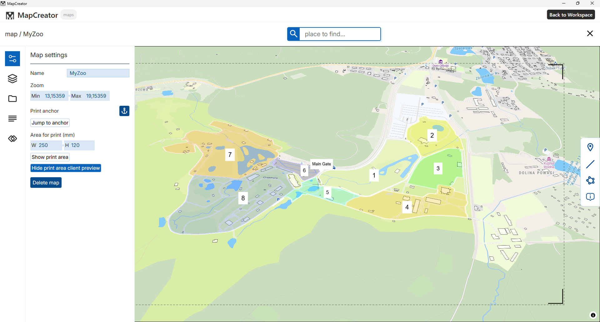

### Layers panel
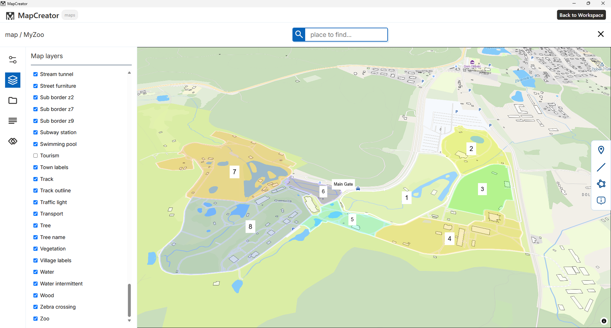 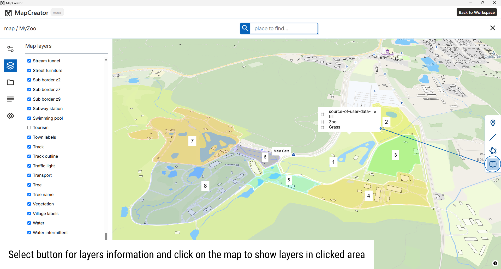

> Disabled layers are scoped to a map style. Each map style a user adds to the workspace can have its own set of disabled layers, independent of other styles.

### Drawings panel
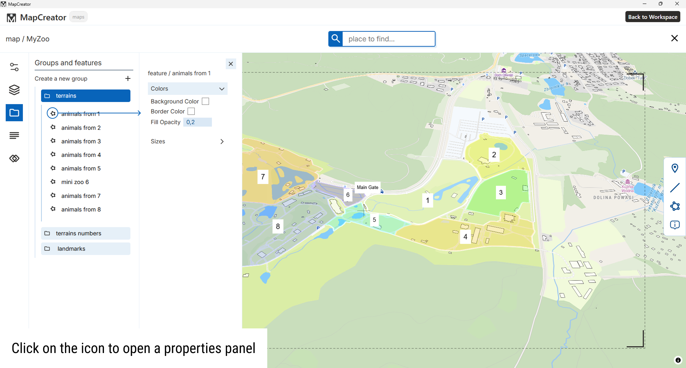

> Drawings shortcuts:
>
> - **Escape** equals to *close drawing*,
> - **Enter or double click on the map** equals to *finish drawing*,
> - **Backspace** equals to *remove last draw point*

> Polygon with two points or line with one point won't create a new drawing.

### Description panel
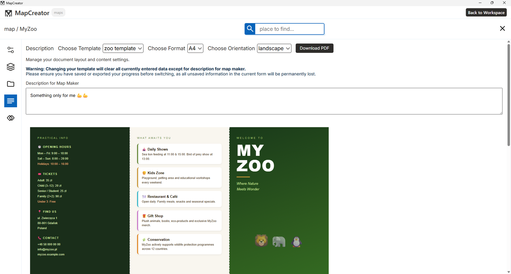 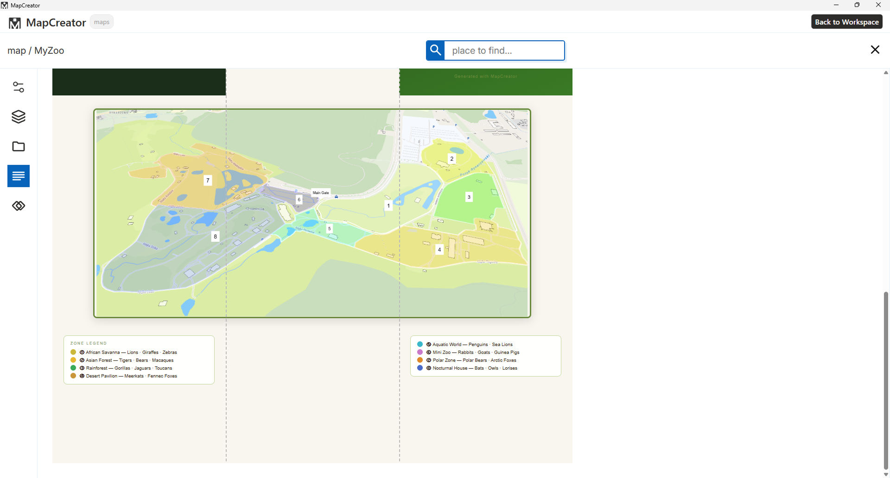

### Combine drawings panel
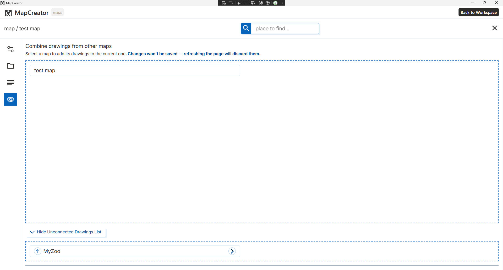

> Combined drawings are not included on the map in template.

### Final product
Images of PDF pages:

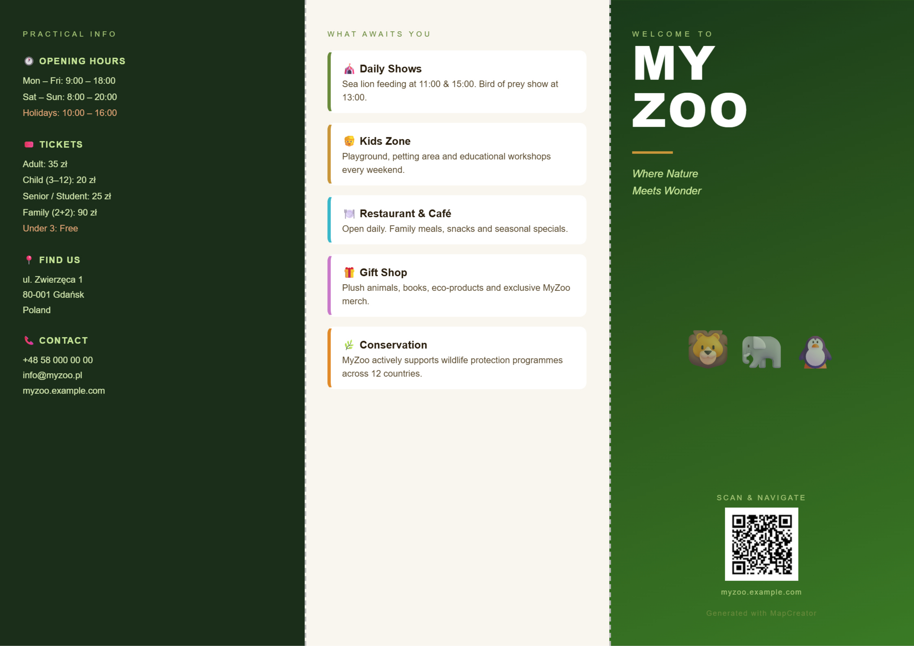 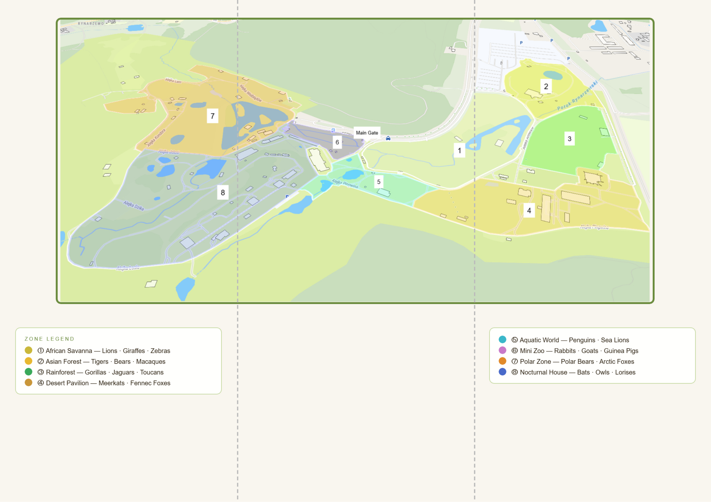

</details>

## Features

- Draw, edit and delete lines, polygons and markers on the map
- Add descriptions to your maps
- Import custom HTML templates (see [Templates](#templates))
- Fill textarea and input fields directly within templates
- Export templates to PDF
- Add and edit your own map style URL
- Work with many map styles
- Disable map layers, scoped to the map style
- Import and export your data
- Built-in auto-update (checks GitHub Releases on startup)

## Installation

Download and run the installer from the [latest release](https://github.com/TimiDev-be/MapCreator/releases/latest).

> **Requirements:** Windows 10 or later. The installer downloads the WebView2 runtime automatically if it is missing.

### Where your data lives

Everything is stored locally in `%LocalAppData%\MapCreator`:

| File | Content |
| --- | --- |
| `data.json` | maps and templates |
| `styles.json` | your map styles |
| `logs/` | application logs |

> Back up `data.json` before updating or reinstalling.

## Architecture

```
┌──────────────────────────── Desktop (WPF) ────────────────────────────┐
│                                                                       │
│   WebView2 ──► React app (Vite build, served from wwwroot/dist)       │
│       ▲                          │                                    │
│       │                 HTTP API / WebSockets                         │
│       │                          ▼                                    │
│       └───────────── ASP.NET Core Minimal API (embedded)              │
│                                  │                                    │
│                          DataService / StyleService                   │
│                                  ▼                                    │
│                      %LocalAppData%\MapCreator\*.json                 │
└───────────────────────────────────────────────────────────────────────┘
```

## Development

**Requirements:** [.NET 10 SDK](https://dotnet.microsoft.com/download), [Node.js](https://nodejs.org/) and npm.

```bash
git clone https://github.com/TimiDev-be/MapCreator.git
cd MapCreator/desktop
dotnet run
```

The desktop project builds the React frontend automatically (`npm install` + `npm run build` in `client`) and copies it to `wwwroot/dist`.

To work on the React app in dev mode, keep the desktop app running (it provides the HTTP server) and start Vite:

```bash
cd client
npm install
npm run dev
```

To change the application's localhost port, edit `config.json` in `client/public`:

```json
{
  "api": {
    "link": "http://localhost:5550/api",
    "port": 5550
  },
  "websockets": {
    "link": "ws://localhost:5550"
  }
}
```

Useful scripts (in `client`):

| Command | Description |
| --- | --- |
| `npm run dev` | Vite dev server |
| `npm run build` | production build |
| `npm run lint` | ESLint |
| `npm run preview` | preview the production build |

## Templates

You can build your own **HTML** templates. Example:

```html
<!-- class "template" is required (width/height is in pixels -> a4 format in 96dpi) -->
<div class="template" style="width: 793px; height: 1122px; padding: 20px;">
  <!-- class "page" is required to define each page even if you want only one -->
  <div class="page" style="width: 100%; height: 100%;">
    <!-- id "map-container" is required if you want to display the map -->
    <div id="map-container" style="width: 500px; height: 300px; padding: 10px; display: flex; justify-content: center; align-items: center;"></div>
    <!-- id "qrcode" is required if you want to display the QR code for Google Maps -->
    <div id="qrcode" style="width: 200px; height: 200px; padding: 10px;"></div>
    <div class="description-container" style="width: 500px; height: max-content; padding: 10px;">
      <h3>Description</h3>
      <!-- All textareas and inputs get listeners when the template is loaded, so values are saved to the map description. -->
      <textarea name="description" id="description-textarea" style="width: 100%; height: 100px; resize: none; font-size: 16px"></textarea>
    </div>
  </div>
</div>
```

The `name` of each textarea / input is used as a key in the `values` object of the map description:

```ts
map: any {
  ...prevmap,
  description: {
    ...prevmap.description,
    values: Record<string, string> = {
      "description": "some text"
    }
  }
}
```

## License

This project is licensed under the [MIT License](LICENSE).
It was made possible thanks to the open-source packages listed in [THIRD_PARTY_LICENSES.md](THIRD_PARTY_LICENSES.md).
